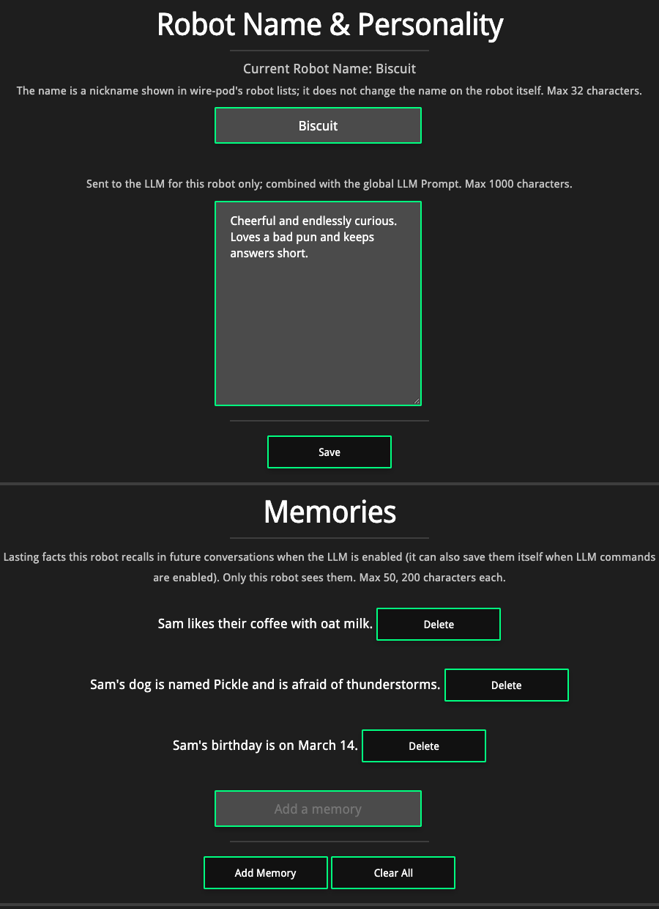

# Per-robot name, personality and memories

With an LLM provider enabled, each Vector on your wire-pod can have its **own name, its own personality, and its own long-term memories**. They share a server, but not a brain.

Everything here is in the regular web UI: **Bot Settings**, pick a robot, then the **Name** tab.

Robots with no name, personality or memories behave exactly as before, and existing `botSdkInfo.json` files load unchanged. None of this does anything unless the LLM is enabled (**Settings > AI & knowledge**, OpenAI-compatible providers: OpenAI, Together, custom). Houndify doesn't use it.

## Name and personality

- **Name** (up to 32 characters). The LLM is told "Your name is ...", which overrides any name in your global prompt. It also shows up in the robot pickers and battery tooltips as `Name (serial)`. It does **not** rename the robot itself, and it is not the wake word: the robot listens for "Hey Vector" in its own firmware.
- **Personality** (up to 1000 characters, plain English), for example "Grumpy but secretly kind, loves astronomy".

Both are added in front of your global LLM prompt, for that robot only, so the global prompt still sets the ground rules.

## Memories

Each robot keeps a short list of lasting facts, added to its prompt on every question.

- **The robot saves facts itself.** The LLM has a silent `rememberFact` action ("my dog is named Pickle"). This needs **LLM commands** enabled; whether a fact gets saved is the model's call.
- **You can add, delete, or clear them** on the Name tab.
- **They are per robot.** A robot only ever sees its own memories.
- Limits: 200 characters per memory, 50 per robot. Duplicates (ignoring case) aren't added twice; the 51st fact pushes out the oldest.
- They're stored by wire-pod, not the robot, as `memories/<serial>.json` in wire-pod's data directory next to `jdocs/` (one file per robot, written atomically). The Docker image persists that folder.

Memories are separate from saved conversations: clearing one doesn't touch the other.

## HTTP API

All under `/api-sdk/`, form-encoded, `serial` identifies the robot.

| Endpoint | What it does |
|---|---|
| `POST set_robot_identity` (`serial`, `name`, `personality`) | Set either or both; an empty value clears it. |
| `GET get_robot_memories?serial=` | JSON list of `{id, text, created}`. |
| `POST add_robot_memory` (`serial`, `text`) | Add one (400 if empty or too long). |
| `POST delete_robot_memory?serial=&id=` | Delete one. |
| `POST clear_robot_memories?serial=` | Delete all. |

## Privacy

With a local model nothing leaves your network. With OpenAI or Together the prompt, including the robot's name, personality and memories, is sent to them. wire-pod's web page has no login: anyone on your network can read a robot's memories, so don't store anything private.
