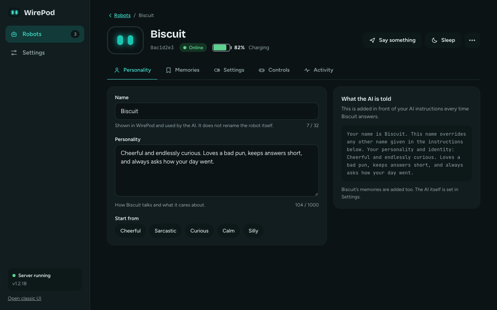
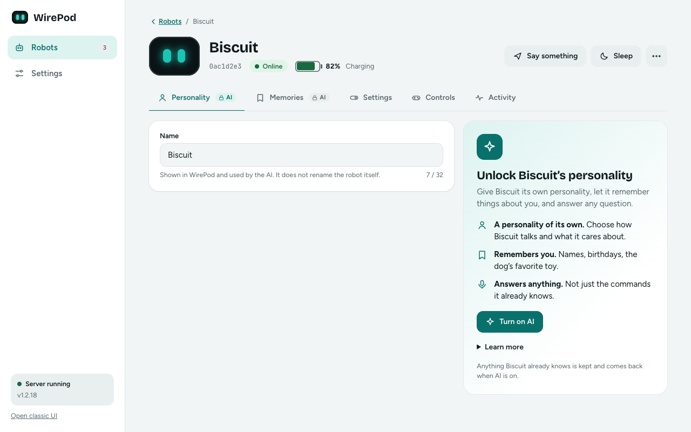
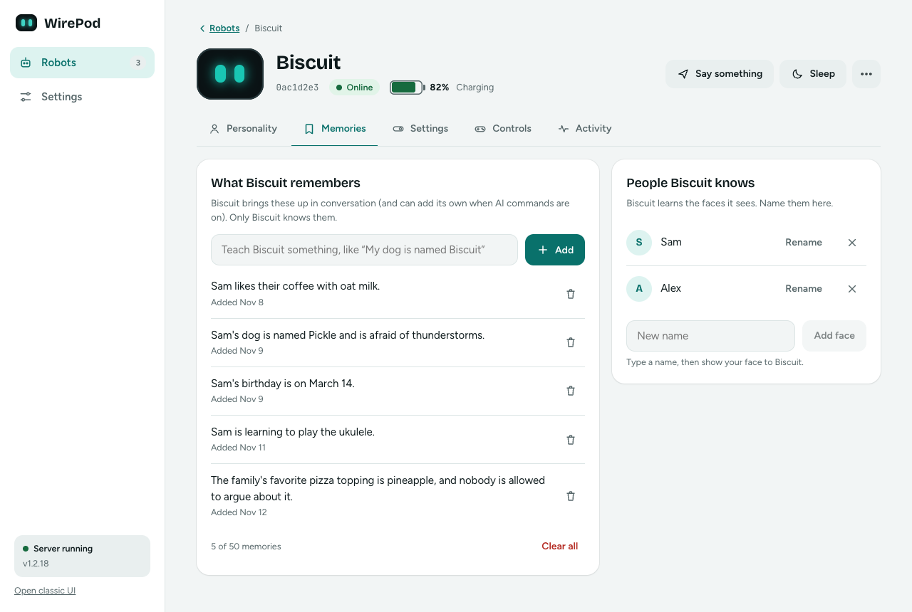
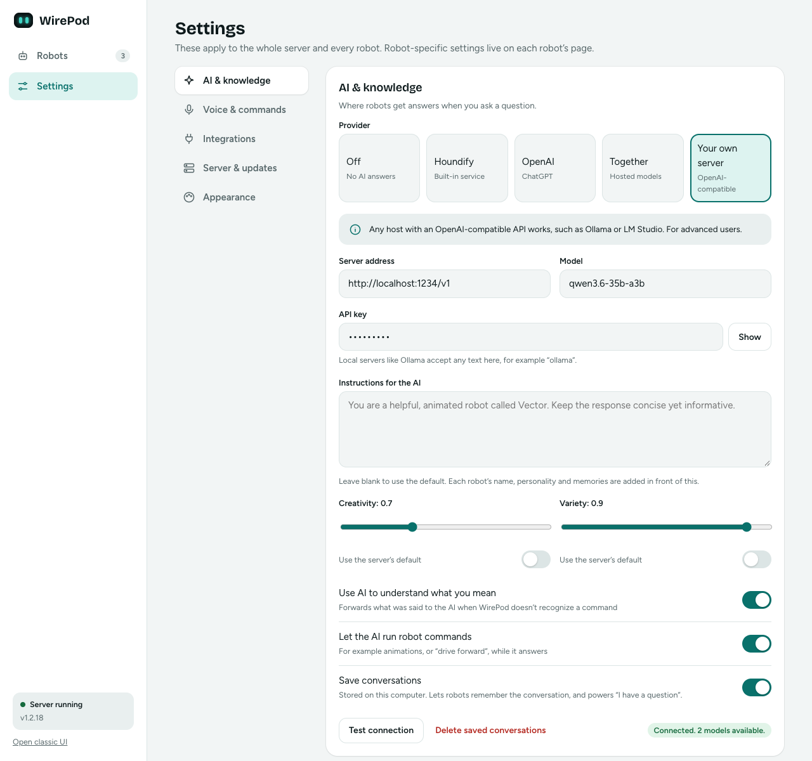

# Give your Vector a mind of its own

With an AI provider switched on, every Vector on your wire-pod can have its **own name, its own personality, and its own memories**. Biscuit can be a cheerful punster who remembers your dog's name. Skipper can be a space pirate who is secretly afraid of the vacuum cleaner. They share a server, but they don't share a brain.

Everything below lives in the new web UI at `/next` (see [the tour](new-ui.md)). The same data is available over the HTTP API.

## Turn it on

1. Open **Settings > AI & knowledge**.
2. Pick a provider. **Your own server** works with a model running on your own computer (see [Run it free and local](#run-it-free-and-local)); **OpenAI** and **Together** are hosted.
3. Switch on **Let the AI run robot commands** (this is how Vector saves memories by himself) and, if you want him to remember the thread of a chat, **Save conversations**.

Name, personality and memories apply to the OpenAI-compatible providers (OpenAI, Together, your own server). Houndify has its own answers and doesn't use them.

If AI is off, the Personality and Memories tabs show an invitation to turn it on. Nothing is lost: everything you set is kept and comes back the moment AI does.

## A name and a personality for each robot

Open a robot, then **Personality**.

- **Name**: up to 32 characters. The AI is told "Your name is ...", and that overrides any name in your general instructions. This does *not* rename the robot itself, and it is not the wake word (see the [FAQ](#faq)).
- **Personality**: up to 1000 characters, in plain English. "Grumpy but secretly kind, loves astronomy, speaks like a pirate" is a complete personality. The **Start from** chips (Cheerful, Sarcastic, Curious, Calm, Silly) fill in a starting point you can edit.
- **What the AI is told** (right-hand panel) shows the exact text added in front of your instructions each time that robot answers. No mystery.

A robot's name, personality and memories are placed *before* your global instructions from Settings, so the global text still sets the ground rules (for example "keep it short") and each robot adds its own character on top.

## Memories: Vector remembers

Each robot keeps a short list of lasting facts and gets it back with every question.

- **Vector saves facts himself.** The AI has a silent action called `rememberFact`. Tell him "my dog is named Pickle" and a capable model will quietly file it away. He won't announce it. (This needs **Let the AI run robot commands** to be on; if it's off, the Memories tab says so and offers a one-click fix.)
- **You can see them all.** Open **Memories** to read what a robot knows, in plain sentences.
- **You can add your own.** Type "Sam's birthday is March 14" and press Add.
- **You can delete any of them.** The bin removes one (with a 7-second Undo); **Clear all** removes the lot.
- **They're per robot and private to each.** A robot only ever sees its own memories. What Biscuit knows about Sam, Skipper doesn't.
- **They're kept by wire-pod, not the robot**, so you can read and edit them while the robot is switched off.

Limits: 200 characters per memory and 50 per robot. Duplicates (ignoring case) aren't added twice. If Vector saves a 51st fact, the oldest one makes room. Memories are stored as one small JSON file per robot in wire-pod's data folder (`memories/<serial>.json`), and the Docker image keeps that folder across restarts.

### Memories vs. conversation history

These are different things. **Memories** are a short list of facts that last until you delete them. **Saved conversations** (next section) are the recent back-and-forth. Deleting saved conversations does not touch memories.

## Conversation mode

Turn on **Save conversations** and robots remember what was said earlier in the chat, so "what about the one in Peru?" makes sense after "what's the tallest mountain?". The recent lines show up in a robot's **Activity** tab. They're stored on your computer, and **Delete saved conversations** wipes them for every robot.

In conversation mode the AI is told to answer and stop, unless you explicitly ask to keep chatting. Say "let's chat" and he can use the `newVoiceRequest` action to listen again right after he finishes speaking, so you can reply without saying the wake word again.

## Run it free and local

You don't need a subscription. Any server that speaks the OpenAI API will do. Two easy ones:

| | Start the server | Address to enter in wire-pod |
|---|---|---|
| **LM Studio** | Load a model, open the **Developer** tab and start the local server | `http://localhost:1234/v1` |
| **Ollama** | `ollama serve` (it runs in the background once installed) | `http://localhost:11434/v1` |

Then in wire-pod: **Settings > AI & knowledge > Your own server**, enter the address and the model name exactly as the server lists it, and type any text for the API key (local servers ignore it). Press **Test connection**; it should say "Connected" and how many models it found. Save, and you're done. If the model runs on a different computer, use that computer's address and make sure the server is reachable on your network.

**A model we like: Qwen3.6-35B-A3B.** It's a "mixture of experts" model: 35 billion parameters in total, but only about 3 billion are used for each word, so it answers quickly for its size. You need a computer with plenty of memory for it (a 4-bit version is roughly 20 GB). If that's too much, a smaller instruct model will still chat; it may be less reliable with the robot's animation and memory commands.

**Tip: turn thinking off.** Many recent models "think" before they answer. That's great for puzzles and terrible for a robot, because Vector waits in silence while the model reasons. Look for a Thinking or Reasoning switch in your server's settings for the model and turn it off, or pick a non-thinking "instruct" variant instead. Replies start much sooner.

On a custom server the **Creativity** and **Variety** sliders (temperature and top-p) are yours to set. Leave them on the server's default if you're unsure.

## Try saying...

Start with the usual **"Hey Vector"**, then:

- "I have a question." (then ask anything)
- "My dog is named Pickle." (a good model will remember it)
- "Remember that my sister Maya is allergic to cats."
- "What's my dog's name?" (days later, after a restart: still known)
- "Tell me a pirate joke." (works best with a pirate personality)
- "Let's chat." (he keeps listening between replies)
- "What do you remember about me?"

Whether a fact is saved is the model's call, not a guarantee. If you'd rather be certain, add it on the Memories tab.

## Privacy

- **With a local model, nothing leaves your home.** Speech recognition (Vosk or whisper.cpp) runs on your computer too.
- **With OpenAI or Together, the prompt is sent to them:** what you said (as text), the robot's name and personality, and its memories. Choose a local server if that bothers you.
- Memories and saved conversations are plain files on the computer running wire-pod. You can delete them from the UI at any time.
- wire-pod's web page has no login. Anyone who can open it on your network can read a robot's memories. Don't put anything in there you wouldn't write on the fridge.

## FAQ

**Why is the wake word still "Hey Vector"?**
The robot listens for its wake word itself, in its own firmware, and only then streams audio to wire-pod. wire-pod can't change what the robot listens for, so a name you set isn't a wake word. It is what the AI *calls itself* once you've woken him up.

**Does setting a name rename the robot?** No. It's the name wire-pod shows and the AI uses.

**Can two robots share memories?** No, by design.

**Vector isn't saving anything.** Check that **Let the AI run robot commands** is on, that you're using an OpenAI-compatible provider, and that your model is capable enough to follow the action format. You can always add memories by hand.

**What if I turn AI off?** The Personality and Memories tabs lock, but your data is kept and your provider settings are preserved. Turn AI back on and everything returns.

**Do my old settings still work?** Yes. Robots with no name or personality behave exactly as before.

**Why is there a 50-memory limit?** Memories are sent with every question, so a long list makes every answer slower and costlier. Fifty short facts is a lot of knowledge about a household.
