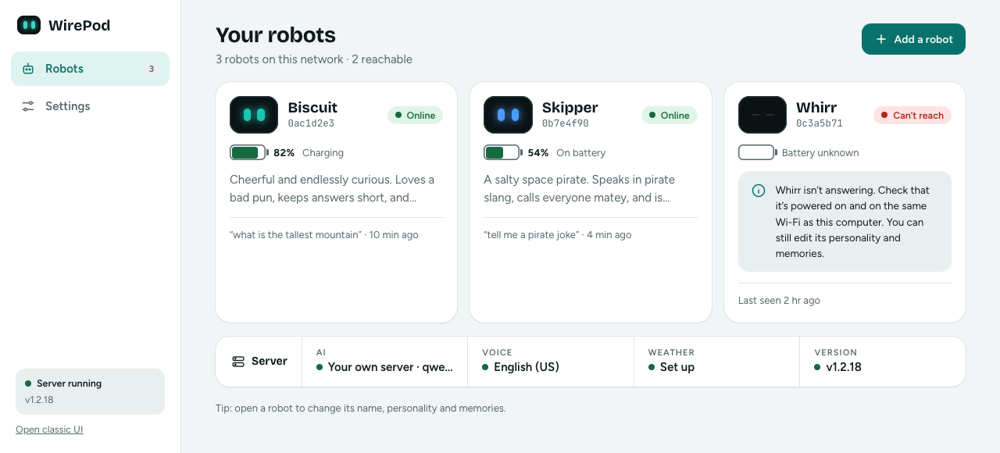
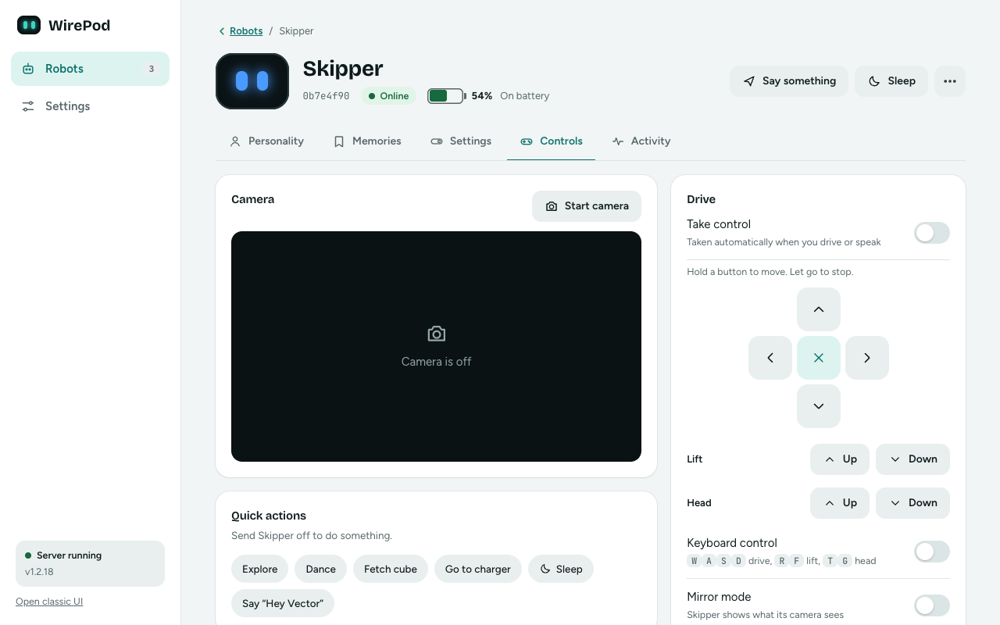
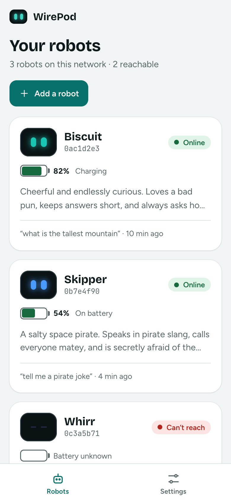
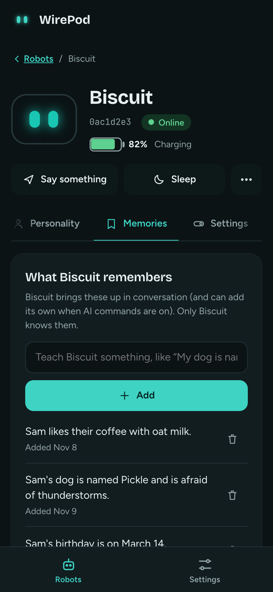

# The new WirePod web UI

A fresh front page for wire-pod: one place to see your robots, give them personalities and memories, drive them, and manage the server. It opens at **`/next`**, and `/` now redirects there. The original UI is still at **`/classic`**.

It's plain HTML and JavaScript served by wire-pod itself. There's nothing to install, no Node at runtime, and no internet needed: the fonts, icons and the small [Preact](https://preactjs.com) library are vendored in the repo.

## Try it

Open `http://<your wire-pod address>:8080/next/` (the same address you already use, plus `/next/`). A fresh install starts with a short setup; an existing one lands on your robots.

## A quick tour

**Robots** (home). One card per robot with its name, serial number, online state, battery, personality, and the last thing it heard. Robots that are off don't slow the page down: it shows what it last knew and keeps checking quietly. A strip along the bottom summarises the server (AI, voice, weather, version).

**A robot's page** has five tabs.

| Tab | What it does |
|---|---|
| **Personality** | The robot's name and personality, with a live preview of what the AI is told. See [AI features](ai-features.md). |
| **Memories** | What the robot remembers (add, delete, clear), plus the faces it knows. |
| **Settings** | Things stored on the robot: volume, eye colour, button behaviour, Alexa sign-in, language, clock, units, time zone, weather location. Each change saves as soon as you make it. |
| **Controls** | Camera, a drive pad, lift and head, "say something", play a sound, quick actions (explore, dance, fetch the cube, go to the charger, sleep) and mirror mode. |
| **Activity** | Recent conversations, lifetime stats, mood, photos and a technical log filtered to that robot. |

**Settings** (whole server) has five sections: **AI & knowledge**, **Voice & commands** (speech language and your custom commands), **Integrations** (weather), **Server & updates**, and **Appearance**.

**Add a robot** and the **first-run setup** walk you through connection, language, pairing and naming. Bluetooth pairing itself is still the tried-and-tested flow from the classic UI: the new page sends you to it (`/classic#bot-setup`) and picks the robot up when it appears.

### If AI is off

Personality and Memories stay visible but locked, with a friendly "turn on AI" panel. Your data is kept. One click on **Turn on AI** takes you to the right settings and brings you back to the robot.

## Keyboard

The whole UI works without a mouse, and is built to be friendly to screen readers.

- **Tab** moves through everything in a sensible order. A **Skip to content** link appears first.
- When you move to a new screen, focus goes to its heading so a screen reader announces where you are.
- On a robot's tabs, **Left / Right** move between tabs; **Home / End** jump to the first or last.
- **Escape** closes menus and dialogs and puts focus back where it was.
- On **Controls**, switch on **Keyboard control** to drive with the keys: **W A S D** to move, **R / F** for the lift, **T / G** for the head. Let go to stop. The drive buttons also work with **Space** or **Enter** held down.
- Unsaved changes ask before you close the tab, and deleted memories can be undone for a few seconds.

## Phone and tablet

It's designed phone-first and scales up. Below about 900 px wide the side rail becomes a bottom tab bar, cards stack, buttons get larger tap targets, and the Settings sections become a list you drill into. Use it from the couch with the robot on your lap.

Appearance (under **Settings > Appearance**) is saved on each device: light, dark or follow-the-system theme, an accent colour (or let it follow the robot's eye colour), larger text, and a retro pixel font if you miss the classic look.

## Performance on low-end hardware

wire-pod targets a Pi 4 and can run on a 3B+, so the new UI is kept light: the server caches and compresses it, and it only polls while you are looking at something that needs it. Classic and the API are unchanged.

- **Caching (`/next` only).** `vendor/` and `fonts/` are cached for a year at `?v=<hash>` URLs written into `index.html` and `app.css` as they are served, so an upgrade still busts them. The app's own JS, CSS and HTML are `no-cache` with an ETag, so a reload is a 304 with no body.
- **Compression.** Text (js, css, html, svg, json) is gzipped once, kept in memory and sent when `Accept-Encoding` allows. The woff2 fonts are sent as they are.
- **Polling.** Nothing polls in a hidden tab, and the fast panels (Mood 0.5 s, live logs 1.5 s, conversations 10 s) only poll while on screen. A poll that keeps failing waits twice as long each time, up to a minute; the robot list does the same while every robot is offline. Only the screens that show robot status poll it, so Settings does not.
- **Server.** `robots_status` answers from the last probe and probes each robot at most once per 5 s however many tabs are open. A robot that stays offline is probed less often (10 s, 20 s, 40 s, then once a minute); "Check again" overrides that.

### Measured

On a Mac (Apple silicon) with the real web handler and `webroot`, headless Chrome and a mock robot API, over loopback. **Not tested on a Pi**: these show how much the page asks for, not Pi timings.

| One load of the home screen | Before | After |
|---|---|---|
| Cold, no gzip (curl) | 357 KB | 359 KB (two small new modules) |
| Cold, gzip (curl) | 357 KB | **217 KB** |
| Warm visit (curl) | 357 KB (`no-store`: refetched) | **5 KB** (28 x 304, 6 files not requested) |
| Cold / warm in Chrome | 352 KB / 352 KB | 215 KB / 5.7 KB |

What is left cold is mostly the three woff2 fonts (128 KB, already compressed).

| Requests per minute to wire-pod, idle | Before | After |
|---|---|---|
| Robots (home) | 19 | 19 |
| Robots, every robot offline | 20 | 10 |
| A robot, Personality tab | 12 | 12 |
| A robot, Activity, Mood in view | 137 | 137 |
| A robot, Activity, Mood scrolled away | 137 | 18 |
| Settings > Appearance | 12 | 0 |
| Settings > Server, live log in view | 52 | 40 |
| Settings > Server, live log scrolled away | 52 | 0 |
| Hidden tab, any screen | 0 | 0 |

Mood and the live log are fast so they feel live: same cost as before while you look at them, nothing when you don't.

**Against classic.** Classic loads 12 local files (235 KB, `no-store`, refetched on every reload) plus Font Awesome from a CDN (`kit.fontawesome.com`, which pulls more from `ka-f.fontawesome.com`), so it needs internet to look right. The new UI is now about the same size cold (215 KB), has no outside requests, and is 5 KB warm. Classic is idle-quiet on its front page (0 requests a minute; it polls only inside panels you open, and those keep polling in a hidden tab).

**Time until the robot cards are drawn** (loopback, median of 3): 47 ms cold / 39 ms warm before, 44 / 39 after; with Chrome's CPU throttled 6x, 187 / 107 ms before and 189 / 105 ms after. Loopback has no bandwidth to save, so this barely moves; the gain is the bytes above on Wi-Fi to a Pi, and the CPU the Pi does not spend sending them.

## Where did the classic UI go?

Nowhere. It's at **`/classic`**, linked from the bottom of the side rail ("Open classic UI"), and every old address (`/index.html`, `/setup.html`, `/initial.html`, `/sdkapp/...`) still works, so bookmarks and scripts keep working. The classic page also has a link to try the new interface.

Anything the new UI doesn't do yet is still there: for example Bluetooth pairing and the OSKR/developer-robot setup live in the classic UI.

## For developers

The code is in `chipper/webroot/next` (see its `README.md`). No build step: edit a file, refresh the page. `js/api.js` is the only place that talks to wire-pod. Run the small logic tests with `node --test chipper/webroot/next/test/*.mjs`.
